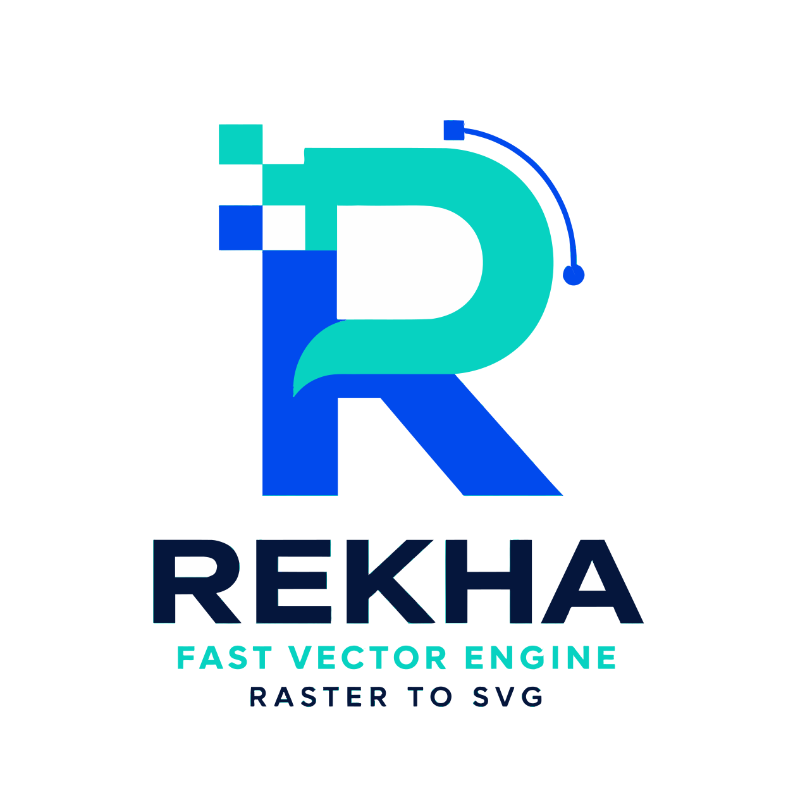
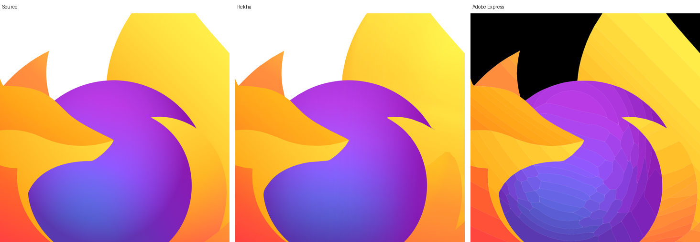
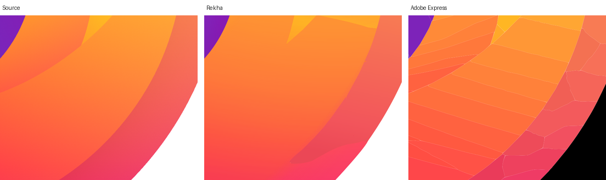
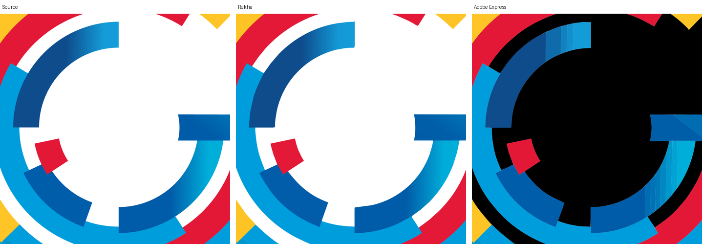
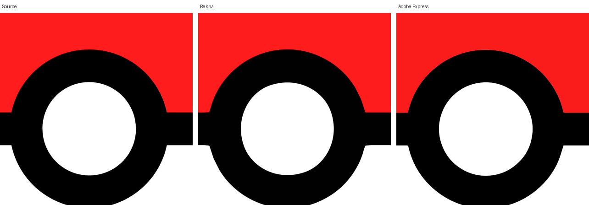

<p align="center"></p>

<h1 align="center">Rekha</h1>

<p align="center"><strong>Raster to clean SVG. Pure Go. Your image never leaves your machine.</strong><br><a href="https://vexyl-ai.github.io/rekha/demo/">Try it in your browser</a></p>

<p align="center">
<a href="https://github.com/vexyl-ai/rekha/actions/workflows/ci.yml"></a>
<a href="https://pkg.go.dev/github.com/vexyl-ai/rekha"></a>
<a href="LICENSE"></a>
<a href="COMMERCIAL.md"></a>

<a href="https://vexyl-ai.github.io/rekha/demo/"></a>
</p>

Rekha converts raster images (PNG, JPEG, GIF) into editable SVG. One codebase provides a Go library, a command-line tool, an HTTP service and a WebAssembly build for the browser. It has no cgo and no dependency beyond `golang.org/x/image`, and it is a clean-room implementation, dual-licensed: AGPL-3.0 for open source, a [commercial licence](COMMERCIAL.md) for everything else.

## Contents

- [Features](#features)
- [Installation](#installation)
- [Quick start](#quick-start)
- [Options](#options)
- [Library](#library)
- [Browser and WebAssembly](#browser-and-webassembly)
- [HTTP API](#http-api)
- [Quality and benchmarks](#quality-and-benchmarks)
- [Limitations](#limitations)
- [Provenance](#provenance)
- [Documentation](#documentation)
- [Author](#author)
- [Licence](#licence)

## Features

- **Curve refinement.** `--refine` optimises every Bézier against the image's anti-aliasing (after Yang et al., 2016), placing edges to a fraction of a pixel. On anti-aliased test images this adds 5–20 dB PSNR at about the same node count.
- **Geometric primitives.** Circles become four exact arcs, rounded rectangles four lines and four arcs with one shared radius, rotated rectangles four nodes. The result edits cleanly in Illustrator, Figma or Inkscape.
- **Gradient fills.** `--gradients` merges colour bands that follow one ramp into a single region filled by a multi-stop `<linearGradient>`, joined across bends, or by a `<radialGradient>` when the bands run round a centre, with specks inside a ramp absorbed. A region shaded more than one way (a sphere with an off-centre highlight, a rim light) is painted in layers: a base gradient under up to two translucent radial gradients that fade by `stop-opacity`, as an illustrator draws it. A 16-megapixel illustration drops from 155 flat paths at 36.7 dB to 82 paths at 39.8 dB with 60 % fewer bytes; flat art is byte-identical with the option on.
- **Clean colour edges.** Anti-aliased pixels between two colours are recognised as their mixture and absorbed, rather than surviving as slivers of a third colour.
- **Three presets.** `bw` for line art and scans, `poster` for flat-colour artwork, `photo` for photographs and soft shading. Every parameter can be overridden.
- **Shared boundaries.** Cutout output fits each boundary between two shapes once, so neighbours carry identical coordinates; stacked output layers shapes with no seams. `--stroke` seals hairline seams in either mode.
- **Small text survives.** On the small-glyphs fixture Rekha reaches 32.26 dB with 86 nodes against Potrace's 32.22 dB with 107.
- **Fast and deterministic.** 0.1–0.25 s per 256×256 image with refinement; 1.1 s plain or 4.6 s refined for a 3.4-megapixel logo on a laptop. The same input gives the same SVG on one core or eight, arm64 or amd64.
- **Progress reporting.** The library reports each stage and its count through a callback; the WebAssembly API and the demo page expose the same.
- **Runs anywhere Go runs.** A single static binary, a capped HTTP service, or the browser via WebAssembly: images traced in the browser are never uploaded.

## Installation

```sh
brew tap vexyl-ai/tap && brew trust vexyl-ai/tap && brew install --cask rekha   # macOS and Linux (brew trust: Homebrew 7 and later)
scoop bucket add vexyl-ai https://github.com/vexyl-ai/scoop-bucket && scoop install rekha   # Windows
docker run --rm -p 8080:8080 ghcr.io/vexyl-ai/rekha   # HTTP API in a container
```

Prebuilt binaries for Linux, macOS, Windows and FreeBSD (amd64 and arm64) are on the [releases page](https://github.com/vexyl-ai/rekha/releases/latest), as archives and as `.deb`, `.rpm`, `.apk` and Arch packages. Each archive holds `rekha` and `rekha-serve`; unpack and put them on your PATH.

```sh
sudo dpkg -i rekha_*_linux_amd64.deb        # Debian, Ubuntu
sudo rpm -i rekha_*_linux_amd64.rpm         # Fedora, RHEL, openSUSE
sudo apk add --allow-untrusted rekha_*_linux_amd64.apk   # Alpine
sudo pacman -U rekha_*_linux_amd64.pkg.tar.zst           # Arch
```

macOS may refuse an unsigned downloaded binary on first run; `xattr -d com.apple.quarantine rekha` clears that.

With Go 1.26 or later:

```sh
go install github.com/vexyl-ai/rekha/cmd/rekha@latest
```

Or from a checkout:

```sh
git clone https://github.com/vexyl-ai/rekha.git
cd rekha
make build        # bin/rekha and bin/rekha-serve
make test         # unit tests and goldens
```

Releases are built by [`.github/workflows/release.yml`](.github/workflows/release.yml) with [GoReleaser](https://goreleaser.com) when a `v*` tag is pushed: binaries, packages, the Homebrew cask in [`vexyl-ai/homebrew-tap`](https://github.com/vexyl-ai/homebrew-tap), the Scoop manifest in [`vexyl-ai/scoop-bucket`](https://github.com/vexyl-ai/scoop-bucket) and the image at `ghcr.io/vexyl-ai/rekha`. `make release-check` builds the binaries and packages into `dist/` locally.

## Quick start

```sh
rekha image.png                                   # writes image.svg
rekha -o out.svg --threshold auto scan.png        # black and white, automatic threshold
rekha --preset poster logo.png                    # flat colours, stacked layers
rekha --preset poster --refine logo.png           # plus curve refinement and primitives
rekha --preset photo --gradients artwork.jpg      # smooth shading as gradient fills
rekha --preset poster --palette "#000000,#ff0000,#ffffff" logo.png
rekha --preset poster --hierarchical cutout --stroke 0.5 logo.png
rekha --mode polygon - < in.png > out.svg         # stdin to stdout
```

Exit codes: `0` success, `1` usage error, `2` a trace failed (remaining inputs are still processed).

## Options

`--preset bw|poster|photo` seeds every default; any flag given on the command line overrides it.

### Colour

| Flag | Default | Description |
|---|---|---|
| `--threshold 0..1\|auto` | `0.5` | `bw` only: cut-off between black and white; `auto` uses Otsu's method |
| `--turn-policy` | `minority` | `bw` only: how a 2×2 checkerboard connects (`minority`, `majority`, `black`, `white`) |
| `--color-tolerance 0..1` | `0.08` / `0.04` | OKLab distance at which colours merge (`poster` / `photo`) |
| `--max-colors N` | `0` | Palette cap; `0` lets the tolerance decide |
| `--palette "#rrggbb,…"` | | Fixed palette, up to 256 entries |
| `--color-precision N` | `6` | Bits per channel in the quantiser |
| `--filter-speckle N` | `4` / `16` | Drop components below N pixels (`poster` / `photo`) |
| `--gradients` | off | Colour presets: merge bands that follow one ramp into a `<linearGradient>` fill, a `<radialGradient>` when they run round a centre, or a base gradient under translucent layers (radial or linear, fading either way) when the region is shaded more than one way |
| `--gradient-tolerance 0..1` | `0.03` | RMS error a ramp may leave, in sRGB units (about 8/255) |

### Curves

| Flag | Default | Description |
|---|---|---|
| `--mode pixel\|polygon\|spline` | `spline` | Output geometry |
| `--simplify px` | `0.75` | Polygon simplification tolerance |
| `--corner-threshold deg` | `60` | Angle above which a vertex is a corner |
| `--fit-tolerance px` | `1.0` / `1.5` | Maximum curve error in the plain fit (`bw`,`poster` / `photo`) |
| `--refine` | off | Optimise curves against the anti-aliasing; replaces recognised circles, arcs, shared radii and rectangles when the rendered error rises by no more than 2 % |
| `--refine-passes N` | `3` | Optimiser sweeps (1–10) |

### Output

| Flag | Default | Description |
|---|---|---|
| `--hierarchical stacked\|cutout` | `cutout` / `stacked` | Shapes with holes sharing one boundary curve, or layered shapes (`bw` / colour presets) |
| `--stroke px` | `0` | Stroke each shape in its own fill to seal hairline seams when viewed enlarged (0–4; `--cutout-stroke` is accepted as an alias) |
| `--path-precision N` | `2` | Decimals in path data |
| `--no-mark` | off | Leave out the generator mark: by default the root carries `data-generator="rekha <version>"` and a comment names Rekha and this repository; neither changes how the image renders |
| `-o, --output` | `<input>.svg` | Output file, or `-` for stdout |

In stacked output the white page is omitted (near-white shapes at depth 0 holding at least half the depth-0 area), so transparent input stays transparent.

## Library

```go
package main

import (
	"image/png"
	"os"

	"github.com/vexyl-ai/rekha"
)

func main() {
	f, _ := os.Open("logo.png")
	img, _ := png.Decode(f)

	o := rekha.PresetOptions(rekha.PresetPoster)
	o.Refine.Enabled = true
	o.Progress = func(stage string, done, total int) { /* quantise, label, …, curves */ }

	res, err := rekha.Trace(img, o)
	if err != nil {
		panic(err)
	}
	out, _ := os.Create("logo.svg")
	defer out.Close()
	res.WriteSVG(out, o)
}
```

`Segment` and `Finish` split the work so a cached segmentation can be re-fitted with new curve options; `TraceReader` decodes PNG, JPEG or GIF from an `io.Reader`. See the [package documentation](https://pkg.go.dev/github.com/vexyl-ai/rekha).

## Browser and WebAssembly

The playground is hosted at [vexyl-ai.github.io/rekha/demo](https://vexyl-ai.github.io/rekha/demo/) behind the product page at [vexyl-ai.github.io/rekha](https://vexyl-ai.github.io/rekha/), both rebuilt from `main` by [`.github/workflows/pages.yml`](.github/workflows/pages.yml) on every push. To run it locally:

```sh
make serve      # builds web/demo/rekha.wasm and serves the site on http://localhost:8080/ (playground at /demo/)
```

The demo page traces entirely in a Web Worker: drop, paste or choose an image, adjust the controls, compare source and SVG with a wipe, zoom and pan the canvas (ctrl/⌘ + wheel or pinch, drag, double-click, toolbar, keys `+` `-` `0` `1`), watch the progress bar, and download the SVG. Nothing is uploaded.

The WebAssembly module exposes `segment`, `finish`, `trace` and `free` on a global `rekha` object, each with an optional progress callback. The API, worker protocol and embedding notes are in [`docs/wasm.md`](docs/wasm.md).

## HTTP API

```sh
go run ./cmd/rekha-serve -static web
curl -F image=@logo.png -F preset=poster -F refine=true localhost:8080/v1/trace > logo.svg
```

`POST /v1/trace` accepts multipart or a raw `image/*` body with options as fields or query parameters, and returns `image/svg+xml`. The server caps request bytes, decoded pixels, wall time, concurrency and queue length. Details in [`docs/server.md`](docs/server.md).

## Quality and benchmarks

All numbers in this file are produced by `make test` and `make bench`; fixtures and commands are in the repository.

| Case | Result |
|---|---|
| Anti-aliased synthetics, `--refine` | +5–20 dB PSNR over the plain fit at about the same node count |
| Small glyphs | 32.26 dB, 86 nodes (Potrace: 32.22 dB, 107 nodes) |
| 3.4-megapixel colour logo, `--preset poster` | 14 paths; PSNR level with VTracer (28.95 vs 28.98 dB), white counters kept white |
| 16-megapixel illustration, `--preset photo --gradients` | 155 → 82 paths, 36.7 → 39.8 dB, 60 % fewer bytes |
| 4-megapixel browser mark, `--preset photo --gradients` | 33 paths at 36.3 dB with layered gradients (flat bands: 31 paths at 34.5 dB), half the bytes; the globe one smooth region, seams between gradients smooth |
| WebAssembly | median 4.5× one-core native; 1.2 MB gzipped |

Recorded baselines: [`bench/results/`](bench/results/). Methodology and reference-tool comparison: [`docs/benchmark.md`](docs/benchmark.md).

### Compared with Adobe Express

Three logos, each a 2048-pixel PNG with a transparent background, traced by Rekha (`--preset photo --gradients`, defaults otherwise) and converted by Adobe Express's image-to-SVG tool (export of 2026-11-11). Both outputs are rendered back at the source size with librsvg and scored against the source over the logo's opaque pixels, so neither tool is charged for how it treats the transparent background. Higher PSNR is closer to the source.

| Logo | Rekha | Adobe Express |
|---|---|---|
| Browser mark (radial shading, translucent layers) | 33 paths, 32 kB, 34.8 dB | 197 paths, 325 kB, 28.7 dB |
| Letter G (concentric ramps) | 16 paths, 14 kB, 32.6 dB | 49 paths, 78 kB, 24.0 dB |
| Ball (flat colours, one highlight) | 5 paths, 4 kB, 33.3 dB | 5 paths, 12 kB, 26.6 dB |

Rekha fits shading as SVG gradients (13 on the browser mark); Adobe Express cuts shading into flat cells, which shows as tiling on anything that fades and multiplies the paths and bytes. On flat art the two agree on the shapes and differ in curve economy.






Numbers and strips: [`bench/results/2026-11-11-adobe-express.md`](bench/results/2026-11-11-adobe-express.md). Vector Magic and Vectorizer.AI are scored the same way when their outputs are placed under `bench/reference/` (see [`docs/benchmark.md`](docs/benchmark.md)).

## Limitations

- Photographs posterise into colour bands; `--gradients` smooths shading that runs along one direction, out from one centre, or in up to two translucent layers over a base, but shading with more structure than that (a third light, a texture) stays banded. An AI pre-pass is planned (roadmap phase 6).
- Cutout output shares boundaries exactly, yet most viewers anti-alias each shape separately and let the page show faintly through shared edges at 1:1. Stacked output is therefore the default.
- Comparisons against Vector Magic and Vectorizer.AI are produced only when their outputs are placed under `bench/reference/` (see `docs/benchmark.md`).

## Provenance

Rekha is written from published algorithms, not from existing tracer code:

- Pipeline design after VTracer's published linear pipeline (MIT / Apache-2.0).
- Curve fitting after Schneider, *An Algorithm for Automatically Fitting Digitized Curves*, Graphics Gems, 1990.
- Refinement after Yang et al., *Effective Clipart Image Vectorization Through Direct Optimization of Bezigons*, IEEE TVCG 2016.

It contains no code derived from Potrace or any other GPL-licensed tracer; Potrace and VTracer are used only as black-box binaries in the benchmark harness. The clean-room rule is in [`CONTRIBUTING.md`](CONTRIBUTING.md). Every commit carries a DCO sign-off.

## Documentation

- [`docs/wasm.md`](docs/wasm.md): WebAssembly API, worker protocol, progress callbacks, demo page.
- [`docs/server.md`](docs/server.md): HTTP API, caps and status codes.
- [`docs/benchmark.md`](docs/benchmark.md): quality measurement and reference tools.
- [`docs/superpowers/specs/2026-11-10-gradients-design.md`](docs/superpowers/specs/2026-11-10-gradients-design.md): gradient fills design.
- [`design/roadmap.md`](design/roadmap.md): phases 0–6, open-core split, legal checklist.
- [`design/refine-bezigon-optimisation.md`](design/refine-bezigon-optimisation.md): refinement stage design notes.

## Author

Rekha is written and maintained by **Anil Mathew** ([LinkedIn](https://www.linkedin.com/in/anilmathewm/)).

Package documentation: [pkg.go.dev/github.com/vexyl-ai/rekha](https://pkg.go.dev/github.com/vexyl-ai/rekha).

## Licence

Dual-licensed.

- **AGPL-3.0** for open source: free to use, change, ship and host, provided what you build with it is released under the AGPL-3.0 too. See [`LICENSE`](LICENSE) and [`NOTICE`](NOTICE).
- **Commercial licence** for products, services and internal tools that will not release their source. It funds the development of the open version. See [`COMMERCIAL.md`](COMMERCIAL.md).

Versions published before this change (up to commit `fe2e104`) remain under the Apache License 2.0 they were released with.
